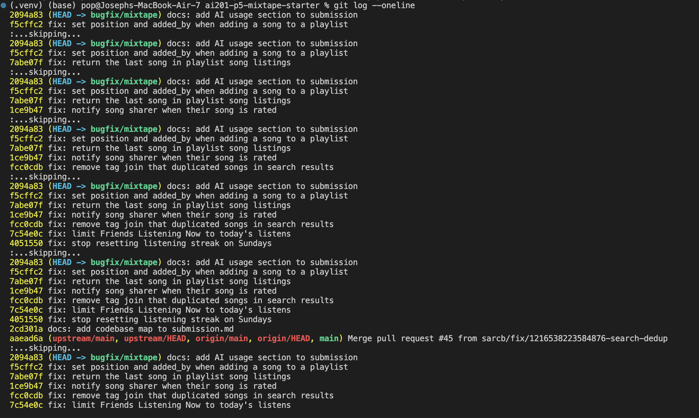
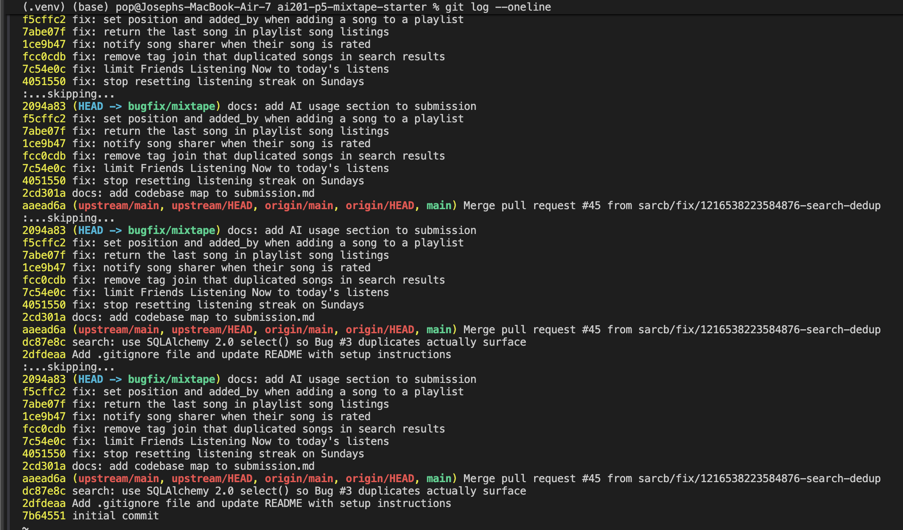

# Project 5 — Mixtape Bug Hunt: Submission

**Branch:** `bugfix/mixtape`

## AI Usage

I used **Claude Code** (Claude Opus 5.5, running in VS Code) as a pair programmer for the whole project. It read files, ran commands against the local app, and drafted code and documentation, which I reviewed. Specifically:

- **Orientation.** Claude read `README.md`, `models.py`, every route and service file, `seed_data.py`, and the tests, then summarised each module's responsibility and traced the rate-a-song, add-to-playlist, and view-playlist call chains. That became the codebase map below. Before any code changed, it ran the existing test suite to get a baseline (4 failing tests, which lined up with Issues #1, #3, and #5).
- **Reproduction before fixing.** For #3, #4, and #5 it used `curl` against the running Flask app with seeded data. For the time-dependent bugs (#1 Sunday, #2 "yesterday"), it wrote a throwaway script with an in-memory DB that calls the service functions with controlled datetimes. No code changed until all five bugs were reproduced.
- **Confirming hypotheses with evidence instead of guessing.**
  - #1: printing `weekday()` next to the streak showed the resets landed exactly on `weekday() == 6`.
  - #3: counting the raw joined rows per title showed rows = tag count. Claude's explanation, that the legacy `Query` API de-duplicates while `select().scalars()` doesn't (which is why PR #45 made the bug surface), was a claim I didn't want to take on trust. We ran the same join through `db.session.query(Song)` and got 1 row against 3, which confirmed it.
  - #4: comparing `add_to_playlist()` and `rate_song()` line by line, and searching for every `create_notification` call, showed only one call site.
- **Writing fixes and tests.** Claude drafted each fix and the regression tests. For every new test we checked that it **fails on the original code** (by stashing the fix) and passes with the fix.

**Where the AI was wrong or incomplete, and what needed checking:**
- After the search fix, the first `curl` check still showed duplicates. That wasn't a bad fix: the Flask server (started without `--debug`) was still running the old code. Restarting it showed correct results. This is a reminder to confirm what's actually running before trusting a "still broken" or "now fixed" result.
- While reproducing #5, the add-song endpoint returned 500 for every request. Neither the issue reports nor the README mention this, and the playlist-add notification that #4 describes as "working" exists only because `seed_data.py` inserts it directly. We fixed it as a separate, clearly labelled commit instead of folding it into #4 or #5.
- For #2 there is a real design choice the code can't settle: what "today" means. We chose the UTC calendar day to match the streak logic, and the RCA notes that a per-user local day would need a timezone field.
- The narrative and the design choices in each RCA (UTC "today", notifying on re-ratings, removing the join instead of adding `DISTINCT`) are written down so a reviewer can disagree with them explicitly.

---

## Codebase Map

### Main files and their roles

| File | Responsibility |
|---|---|
| `app.py` | Flask application factory. `create_app(config=None)` builds the app, sets the SQLite URI (`sqlite:///mixtape.db` by default, overridable by `DATABASE_URL` or a `config` dict, which is how the tests use `sqlite:///:memory:`), initialises the shared `db = SQLAlchemy()` object, registers four blueprints under `/songs`, `/playlists`, `/users`, `/feed`, and calls `db.create_all()`. |
| `models.py` | All SQLAlchemy models. 7 model classes: `User`, `Tag`, `Song`, `ListeningEvent`, `Rating`, `Playlist`, `Notification`. It also defines 3 association tables: `friendships` (self-referential User↔User, stored as two directed rows per friendship), `song_tags` (Song↔Tag), and `playlist_entries` (Playlist↔Song, which carries extra columns `position`, `added_by`, `added_at`, so playlist order is explicit). All primary keys are UUID strings. `Rating` has a unique constraint on `(user_id, song_id)` so each user rates a song at most once. `User` stores denormalised streak state (`listening_streak`, `last_listened_at`) and does not recompute it from events. Every model has a `to_dict()` used for JSON responses. |
| `routes/songs.py` | `GET /songs/search?q=`, `GET /songs/<id>`, `POST /songs/<id>/rate`, `POST /songs/<id>/listen`. |
| `routes/playlists.py` | `POST /playlists/` (create), `GET /playlists/<id>` (metadata), `GET /playlists/<id>/songs`, `POST /playlists/<id>/songs` (add a song). |
| `routes/users.py` | `GET /users/<id>`, `GET /users/<id>/streak`, `GET /users/<id>/notifications[?unread_only=true]`, `POST /users/notifications/<id>/read`. This is the only route file that touches the DB directly (`get_user`). |
| `routes/feed.py` | `GET /feed/<id>/listening-now` and `GET /feed/<id>/activity`. |
| `services/streak_service.py` | `record_listening_event()` writes a `ListeningEvent` and calls `update_listening_streak()`, which compares the calendar date of `now` against `user.last_listened_at` to decide whether the streak stays the same, increments, or resets. `get_streak()` just reads the stored column. |
| `services/feed_service.py` | `get_friends_listening_now()` returns each friend's single most recent `ListeningEvent` newer than a cutoff. `get_activity_feed()` returns the latest N friend events with no time filter. |
| `services/search_service.py` | `search_songs()` does a case-insensitive `ILIKE` match on `Song.title` / `Song.artist`. `get_song()` fetches a song by ID. |
| `services/notification_service.py` | Owns notifications **and** the two "interaction" actions that should produce them: `add_to_playlist()` and `rate_song()`. `create_notification()` is the shared helper that inserts and commits a `Notification`. Also `get_notifications()` and `mark_as_read()`. |
| `services/playlist_service.py` | `create_playlist()`, `get_playlist()` (metadata), `get_user_playlists()`, and `get_playlist_songs()`, which joins `Song` to `playlist_entries` and orders by `position`. |
| `seed_data.py` | Drops and recreates the DB, then seeds 5 users (nova, darius, simone, kenji, aaliya), 5 friendships, 10 tags, 13 songs (grouped by 0, 1, and 3 tags), listening events from 10 minutes to ~58 hours ago, 3 playlists with 7 songs each at positions 1–7, and one `song_added_to_playlist` notification. |
| `tests/` | pytest suites for streaks, search, and playlists. Each builds a fresh in-memory app via `create_app({...":memory:"})` and calls service functions directly, not over HTTP. |

### Data flow 1: a user rates a song

1. `POST /songs/<song_id>/rate` with JSON `{"user_id", "score"}` hits `rate()` in `routes/songs.py`.
2. The route checks that both fields are present (400 otherwise), casts `score` to `int`, and calls `rate_song(user_id, song_id, score)` in `services/notification_service.py`.
3. `rate_song()` checks that the score is between 1 and 5, loads the `Song` and the rater `User` with `db.session.get` (raising `ValueError` if either is missing), then looks for an existing `Rating` for that `(user_id, song_id)`. If one exists, it updates the score. If not, it adds a new `Rating`. Then it commits.
4. It returns the `Rating`. The route serialises it with `to_dict()` and returns 201. Any `ValueError` becomes a 400.

### Data flow 2: a user adds a song to a playlist

`POST /playlists/<id>/songs` → `routes/playlists.add_song()` → `notification_service.add_to_playlist(playlist_id, song_id, added_by)`. This loads the Song, User, and Playlist, inserts the song into the playlist, then calls `create_notification(user_id=song.shared_by, notification_type="song_added_to_playlist", ...)` when the adder is not the song's original sharer. The notification is later read through `GET /users/<id>/notifications` → `get_notifications()`, which orders by `created_at` descending.

### Data flow 3: a user views a playlist

`GET /playlists/<id>/songs` → `routes/playlists.get_songs()` → `playlist_service.get_playlist_songs()`. This runs `SELECT song JOIN playlist_entries WHERE playlist_id = ? ORDER BY position ASC` and serialises the songs. The route wraps the list as `{"songs": [...], "count": n}`.

### Patterns I noticed

- **Thin routes, fat services.** Routes only parse JSON or query args, call one service function, and turn the result (or a `ValueError`) into a JSON response with a status code. All business logic and DB access live in `services/`.
- **Errors are `ValueError`.** Services raise `ValueError` for not-found or invalid input, and each route maps it to a 404 (reads) or a 400 (writes).
- **Services commit their own transactions.** Each write service calls `db.session.commit()` itself.
- **Notifications are a side effect of an interaction.** They are not created by a separate event system. The function that performs the interaction calls `create_notification()` inline, which is why `add_to_playlist` and `rate_song` live in `notification_service.py` and not in playlist or song services.
- **Times are UTC.** Models default to `datetime.now(timezone.utc)`. SQLite stores them as naive values, so services re-attach `tzinfo=utc` when they compare them (for example in `update_listening_streak`).
- **Two query styles.** Most services use the legacy `db.session.query(...)` API. `search_service` uses the 2.0-style `db.session.execute(select(...)).scalars()`.

---

## Root Cause Analyses

### **Issue #1 — My listening streak keeps resetting**

**How I reproduced it.** The bug depends on the day of the week and the app reads the real clock, so I didn't use HTTP. I used a Python script with an in-memory DB that calls `update_listening_streak(user, now)` with a controlled `now` for every day from Monday 2024-06-03 to Sunday 2024-06-16 at 09:00 UTC. The streak went 1, 2, 3, 4, 5, 6 and then dropped to **1 on Sunday 06-09**. It went 2 on Monday and 7 by Saturday 06-15, then dropped to **1 again on Sunday 06-16**. That matches kenji's report: it resets only on Sundays and counts normally from Monday. The existing `tests/test_streaks.py::test_streak_increments_on_sunday` also failed (`assert 1 == 2`).

**How I found the root cause.** I started at the route: `GET /users/<id>/streak` (`routes/users.py`) calls `get_streak()`, which only reads `User.listening_streak`, so the value had to be wrong when it was written. The only writer is `POST /songs/<id>/listen` → `record_listening_event()` → `update_listening_streak()` in `services/streak_service.py`. Its docstring lists four rules, and none of them mention weekdays. The branch that should implement "listened yesterday → +1" is `elif days_since_last == 1 and today.weekday() != 6:`. I had my script print `today.weekday()` next to the streak, and the reset happened exactly on rows where `weekday() == 6`. That confirmed the cause.

**The root cause.** `update_listening_streak()` increments only when `days_since_last == 1 and today.weekday() != 6`. Python's `date.weekday()` returns 0 for Monday through 6 for Sunday, so the extra condition is false on every Sunday. A Saturday→Sunday listen (`days_since_last == 1`) therefore skips the increment branch and falls into `else: user.listening_streak = 1`, the branch meant for skipped days. On Monday, `days_since_last == 1` and `weekday() == 0`, so counting resumes from the new value of 1. No documented streak rule involves the weekday.

**My fix.** I removed `and today.weekday() != 6` so the branch is `elif days_since_last == 1:`. That matches the documented rule ("If the user listened yesterday: streak increments by 1") for every day of the week. One line in `services/streak_service.py`.

**Side-effect check.**
- I re-ran my script: the streak now climbs 1→14 across both Sundays.
- I checked both sides of the boundary. Saturday→Sunday increments (`test_streak_increments_on_sunday` now passes), and Friday→Sunday with Saturday skipped still resets to 1 (new test `test_streak_resets_when_saturday_skipped`).
- The same-day no-op (`days_since_last == 0`), first-ever listen, and skipped-midweek reset tests all still pass.
- I added the regression test `test_streak_continues_through_full_week` to `tests/test_streaks.py`. It asserts the streak equals the day count for 14 straight days, so it would have caught the bug.
- `get_streak()` and the `/listen` route needed no changes.

### **Issue #2 — Friends Listening Now shows people from yesterday**

**How I reproduced it.** The seed data puts every friend's latest listen 10–20 minutes before seeding, so I needed a "listened last night" condition. In a script with an in-memory DB I made nova and darius friends and gave darius one `ListeningEvent` at **yesterday 23:00 UTC**. At the time it was 2026-10-13 21:29 UTC, so the event was 22.5 hours old. Calling `get_friends_listening_now(nova.id)` (the function behind `GET /feed/<id>/listening-now`) returned `[('darius', '2026-10-12T23:00:00')]`. Yesterday's listen was showing as "listening now", as nova reported.

**How I found the root cause.** `routes/feed.py` → `listening_now()` → `get_friends_listening_now()` in `services/feed_service.py`. The function picks friend events with `ListeningEvent.listened_at >= cutoff` and then keeps the newest one per friend. Inclusion depends only on `cutoff`, and the cutoff is `datetime.now(timezone.utc) - RECENT_THRESHOLD`, where `RECENT_THRESHOLD = timedelta(hours=24)`. The reporter's phrase "keeps hanging around … until the same time the next day" describes a rolling 24-hour window exactly. That is what convinced me the cutoff was the cause, not the de-duplication loop.

**The root cause.** The feature is meant to show friends who have listened **today**, but the cutoff was a rolling window: "now minus 24 hours". A 24-hour window measured from 9 am today reaches back to 9 am yesterday, so a listen at 11 pm last night counts as recent until 11 pm tonight. The code measured elapsed time, but the requirement is a calendar-day boundary.

**My fix.** In `services/feed_service.py` I changed the cutoff to the start of the current calendar day: `datetime.now(timezone.utc).replace(hour=0, minute=0, second=0, microsecond=0)`. I removed the unused `RECENT_THRESHOLD` and `timedelta` import and updated the docstring to say "today". I used UTC because the whole app stores times in UTC and `update_listening_streak()` already defines a "day" as the UTC date, so the two features now agree on what "today" means.

**Side-effect check.**
- Both sides of the boundary: new test `tests/test_feed.py::test_listening_now_excludes_yesterday` puts one friend at 23:59 yesterday (excluded) and one at exactly 00:00 today (included). It fails on the old code and passes on the new code.
- Reseeded and called `GET /feed/<nova>/listening-now` on the running app: darius, simone, and kenji (all listened minutes ago) still appear, newest first, one entry per friend.
- `get_activity_feed()` shares the module and is intentionally not time-filtered. `test_activity_feed_still_includes_yesterday` confirms yesterday's listen still appears there.
- Known trade-off: "today" is the UTC day, not the user's local day, because the app has no per-user timezone. Showing local days would need a timezone field on `User`, which is out of scope.

### **Issue #3 — The same song keeps showing up twice in search**

**How I reproduced it.** After `python seed_data.py` and with the app running, `GET /songs/search?q=Anthem` returned `count: 3`, with "Crown Heights Anthem" listed three identical times. `?q=Midnight` returned "Midnight Drive" once. A broad `?q=a` returned 23 results for 13 songs. The data condition behind it: the songs that repeated were exactly the ones seeded with 3 tags, while songs with 0 or 1 tag appeared once. The existing `test_search_no_duplicates_multi_tag_song` also failed.

**How I found the root cause.** `routes/songs.py` → `search()` → `search_songs()` in `services/search_service.py`. The query is `select(Song).outerjoin(song_tags, Song.id == song_tags.c.song_id).filter(title ILIKE … OR artist ILIKE …)`. Because the duplicate count matched the tag count, I suspected the join. To confirm, I ran the same join selecting `(Song.title, song_tags.c.tag_id)` and counted rows per title. Every 3-tag song produced 3 rows and every 0- or 1-tag song produced 1 row, the same pattern as the search results. I also read `git log`. The last merged commit (PR #45, "use SQLAlchemy 2.0 select() so Bug #3 duplicates actually surface") switched this query from the legacy `Query` API to `select()`. That explains why this was a conditional bug: the legacy `Query` would de-duplicate single-entity results, which hid the extra join rows, while `session.execute(select(...)).scalars().all()` returns every row.

**The root cause.** `search_songs()` outer-joins `Song` to the `song_tags` association table, but nothing in the query filters or selects on tags. A SQL join yields one row per matching (song, tag) pair, so a song with N tags comes back N times (or once if it has no tags, thanks to the outer join). `.scalars().all()` maps each row to its `Song` object without de-duplicating, so the same `Song` appeared N times in the list. The join was also unnecessary for the output, because `Song.to_dict()` already loads tags through the `Song.tags` relationship (`lazy="subquery"`).

**My fix.** I removed the `.outerjoin(song_tags, …)` line from `search_songs()` and the now-unused `Tag, song_tags` imports. With no join, the query returns one row per `Song` that matches the title/artist filter. I chose removing the join over adding `.distinct()` because the join had no purpose: `.distinct()` would hide the duplicates while still making the database build and then collapse N rows per song.

**Side-effect check.**
- All 5 tests in `tests/test_search.py` pass, including the 0-, 1-, and 3-tag no-duplicate cases and the no-match case.
- Restarted the app. `?q=Anthem` → 1 result. `?q=a` → 13 results, one per seeded song. `?q=zzz` → empty list.
- Tags are not lost: each result's `tags` list still has 0, 1, or 3 entries as seeded, because tags come from the relationship and never came from the join.
- Searching by artist (`?q=Borough`) still finds Crown Heights Anthem, so the `OR` filter is unchanged.
- `get_song()` in the same file doesn't use the join and is unaffected.

### **Issue #4 — I got notified when a friend added my song to a playlist but not when they rated it**

**How I reproduced it.** After seeding, with the app running: `GET /users/<nova>/notifications` → `count: 1`, the seeded `song_added_to_playlist` notification. Then kenji rated a song nova shared: `POST /songs/<Still Waters>/rate` with `{"user_id": <kenji>, "score": 5}` → **201**, and the Rating JSON came back with `score: 5`, so the rating was saved. Re-fetching nova's notifications still gave `count: 1`, with no rating notification, as aaliya reported.

**How I found the root cause.** Following the hint, I compared the working flow with the missing one. Both live in `services/notification_service.py`. `POST /playlists/<id>/songs` → `add_to_playlist()`, and `POST /songs/<id>/rate` → `rate_song()`. Side by side, both functions: (1) validate input, (2) load the `Song` and the acting `User`, (3) write their row and commit. `add_to_playlist()` then has a fourth step: `if song.shared_by != added_by_user_id: create_notification(user_id=song.shared_by, notification_type="song_added_to_playlist", ...)`. `rate_song()` stops after `db.session.commit()` and returns. I also searched for every call to `create_notification`. There is exactly one, in `add_to_playlist`, even though the `create_notification` docstring lists `'song_rated'` as an expected type. That told me the code wasn't failing to deliver a rating notification; it never tried to create one.

**The root cause.** This app has no event bus or model hook that creates notifications automatically. The convention (see the codebase map) is that each interaction function calls `create_notification()` inline, after its write. `add_to_playlist()` follows the convention. `rate_song()` doesn't: it saves or updates the `Rating`, commits, and returns without notifying `song.shared_by`. So no `Notification` row is ever written for a rating, no matter who rates what. That explains why the problem affected "anyone I've asked" and why there was no delay, just nothing.

**My fix.** I added the missing step to `rate_song()`, mirroring `add_to_playlist()`. After the rating is committed, if the rater is not the song's sharer, it calls `create_notification(user_id=song.shared_by, notification_type="song_rated", body=f"{rater.username} rated your song '{song.title}' {score} out of 5.")`. The type string `song_rated` is the one `create_notification`'s docstring already names. The call comes after the score check and the not-found checks, so rejected ratings never notify.

**Side-effect check.**
- Via HTTP after the fix: kenji's rating → nova now has 2 notifications, newest first: `song_rated` "kenji rated your song 'Still Waters' 5 out of 5." above the older playlist one. Nova rating their own song → 201, no new notification. Score 0 → 400, no notification.
- New tests in `tests/test_notifications.py`: the sharer is notified (fails on the old code), self-rating doesn't notify, re-rating still updates the single existing `Rating` instead of violating the `unique_user_song_rating` constraint, and an invalid score raises `ValueError` with no notification.
- `get_notifications()` ordering, `mark_as_read()`, and the playlist-add notification path were not modified.
- Design note: a re-rating also sends a notification (with the new score). I chose that because the reporter expects "a notification for the rating, same as for the playlist add", and a changed score is new information for the sharer.

### **Issue #5 — The last song in a playlist never shows up**

**How I reproduced it.** After seeding, I checked the DB: "Friday Energy" has 7 rows in `playlist_entries` (positions 1–7). `GET /playlists/<Friday Energy>/songs` returned `count: 6`. Harlem Renaissance, the song at position 7, was missing. For the reporter's second step ("adding a song frees the previous one"), `POST /playlists/<id>/songs` returned **500** (`NOT NULL constraint failed: playlist_entries.position`), a separate defect covered in the Additional Fix section below. So I reproduced that step in a script that inserts entries at positions 1–7 directly and calls `get_playlist_songs()`. It returned T1–T6. After I inserted T8 at position 8, it returned T1–T7: T7 was "freed" and the new T8 was hidden, exactly as darius described. The existing tests `test_playlist_returns_all_songs` (expected 5, got 4) and `test_playlist_returns_songs_in_order` also failed.

**How I found the root cause.** `routes/playlists.py` → `get_songs()` → `get_playlist_songs()` in `services/playlist_service.py`. The route only wraps the list and computes `count` from `len(songs)`, so the song was already missing when the service returned. The query joins `Song` to `playlist_entries`, filters by `playlist_id`, and orders by `position ASC`. I ran that query in a shell and got all 7 songs in the right order, so the SQL was fine. The only thing between the query and the return value is `return [song.to_dict() for song in songs[:-1]]`. The "always exactly one, always the newest" symptom matches what `[:-1]` does to a list sorted by ascending position.

**The root cause.** `get_playlist_songs()` builds a correct list ordered by ascending `position` and then returns `songs[:-1]`. In Python, `[:-1]` means "every element except the last", so the function always dropped the song with the highest position. Because new songs are appended at the end, that is always the most recently added song. Adding another song moves the previous one out of the last slot (so it reappears) and puts the new one in the dropped slot. This contradicts the function's own docstring: "This function returns all songs in the playlist."

**My fix.** I changed the return to `[song.to_dict() for song in songs]`, iterating the full result list. One line.

**Side-effect check.**
- All 5 tests in `tests/test_playlists.py` pass. That includes the existing ones for count, position order, and empty playlist (`[]` sliced or not is still `[]`), plus two new regression tests: `test_newly_added_song_is_returned` (adding Track 6 returns Tracks 1–6) and `test_single_song_playlist_returns_that_song`. The second one covers the most extreme failure of the old code, where a one-song playlist came back empty.
- Restarted the app: all three seeded playlists return `count: 7` in position order.
- Re-ran my script: 7 entries → T1–T7, add 8th → T1–T8.
- `get_playlist()` (metadata) and `get_user_playlists()` don't use this function and were unaffected.

---

## Additional Fix (found while reproducing #4 and #5)

### **Adding a song to a playlist always returns 500**

This isn't one of the five tracker issues. I fixed it because it blocked the reproduction steps of two of them ("Added one more song (POST /playlists/<id>/songs)" in #5, and the working playlist-add notification that #4 compares against).

**How I reproduced it.** On the freshly seeded app, `POST /playlists/<Friday Energy>/songs` with a valid `song_id` and `added_by` returned **500 Internal Server Error** for every song and user I tried. The Flask log showed `sqlite3.IntegrityError: NOT NULL constraint failed: playlist_entries.position`. The playlist-add notification visible after seeding was inserted directly by `seed_data.py`, not created through this endpoint.

**How I found the root cause.** The traceback pointed into `add_to_playlist()` in `services/notification_service.py`, at `playlist.songs.append(song)` followed by `db.session.commit()`. In `models.py`, `Playlist.songs` is a plain `relationship(secondary=playlist_entries)`, and `playlist_entries` declares `position` and `added_by` as `nullable=False`. `seed_data.py` and every test build playlists by inserting into `playlist_entries` with explicit `position` and `added_by` values, which is why nothing else exercised this path.

**The root cause.** When you append to a `secondary` relationship, SQLAlchemy writes only the two foreign keys (`playlist_id`, `song_id`) to the association table. It knows nothing about extra columns. `playlist_entries` requires `position` and `added_by`, so every insert violated a NOT NULL constraint, the commit raised `IntegrityError` (not the `ValueError` the route catches), and the request failed with 500 before the notification code was reached.

**My fix.** I replaced `playlist.songs.append(song)` with an explicit `playlist_entries.insert()` that sets `position` to the playlist's current `MAX(position) + 1` (so 1 for an empty playlist) and `added_by` to the adding user. The `if song not in playlist.songs` guard is unchanged, so re-adding a song is still a no-op instead of hitting the composite primary key.

**Side-effect check.**
- Via HTTP: darius added "Frequencies" → 201, count 7 → 8 with Frequencies last, and simone (its sharer) got a notification. Then simone added "Midnight Drive" → 201, count 9 with it last, and nova (its sharer) got "simone added your song 'Midnight Drive' to the playlist 'Friday Energy'."
- New tests `test_add_to_playlist_appends_at_next_position` (also checks that a duplicate add is a no-op) and `test_add_to_empty_playlist_starts_at_position_1` in `tests/test_playlists.py`.
- Full suite: 25 passed.

---

## Regression Tests

Every fix has a test that fails on the original code and passes after the fix. I confirmed this for each new test by temporarily reverting the fix (`git stash`) and re-running it.

| Issue | Test | What it verifies | Why it fails on the buggy code |
|---|---|---|---|
| #1 | `tests/test_streaks.py::test_streak_continues_through_full_week` (new), `test_streak_increments_on_sunday` (existing) | Listening 14 days in a row gives a streak equal to the day count, every day | On Sunday the `today.weekday() != 6` condition sends a consecutive-day listen to the reset branch, so the streak is 1 when the test expects 7 |
| #1 | `test_streak_resets_when_saturday_skipped` (new) | Friday then Sunday (Saturday skipped) still resets to 1 | Passes both before and after. It guards the other side of the boundary, so the fix can't over-correct |
| #2 | `tests/test_feed.py::test_listening_now_excludes_yesterday` (new) | A friend at 23:59 yesterday is excluded and a friend at 00:00 today is included | With the rolling `now - 24h` cutoff, the 23:59-yesterday listen is still inside the window, so both friends come back instead of only simone |
| #2 | `test_activity_feed_still_includes_yesterday` (new) | The un-filtered activity feed still shows yesterday's listen | Side-effect guard: the fix must not touch `get_activity_feed()` |
| #3 | `tests/test_search.py::test_search_no_duplicates_multi_tag_song` (existing) | A song with 3 tags appears exactly once in results | The unused `outerjoin(song_tags)` gives one row per tag, so the song comes back 3 times |
| #4 | `tests/test_notifications.py::test_rating_notifies_song_sharer` (new) | When kenji rates aaliya's song, aaliya gets one `song_rated` notification naming kenji and the song | `rate_song()` never called `create_notification()`, so aaliya has 0 notifications |
| #4 | `test_rating_own_song_does_not_notify`, `test_rating_still_saved_and_updated`, `test_invalid_score_creates_no_notification` (new) | No self-notification, re-rating still updates one row, rejected scores don't notify | Side-effect guards for the new notification code |
| #5 | `tests/test_playlists.py::test_newly_added_song_is_returned`, `test_single_song_playlist_returns_that_song` (new), `test_playlist_returns_all_songs` (existing) | Every song comes back, including the newest, and a one-song playlist returns that song | `songs[:-1]` drops the last element: Track 6 is missing, and the one-song playlist comes back empty |
| Add-song 500 | `test_add_to_playlist_appends_at_next_position`, `test_add_to_empty_playlist_starts_at_position_1` (new) | `add_to_playlist()` stores the song at the next position, and a duplicate add is a no-op | `playlist.songs.append()` leaves the NOT NULL `position` column empty, so the commit raises `IntegrityError` |

Run with `pytest tests/`. Result on this branch: **25 passed**. On `main`, 4 existing tests failed.

---

## Commit History

`git log --oneline` on `bugfix/mixtape`: one `fix:` commit per bug (Issues #1–#5, plus the add-to-playlist fix), with `docs:` commits for this write-up.

